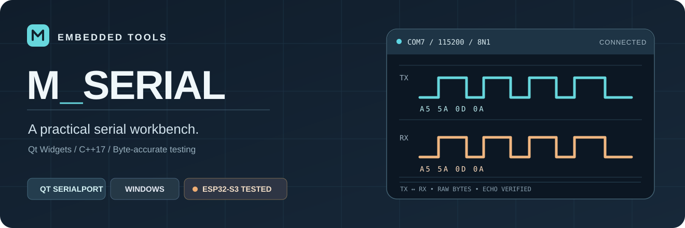
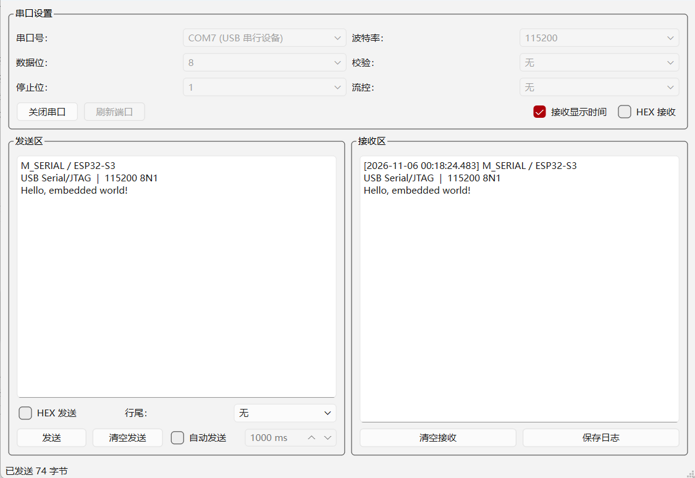
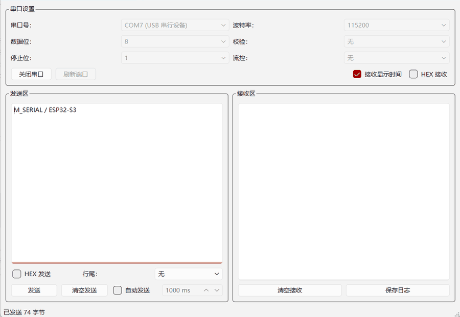
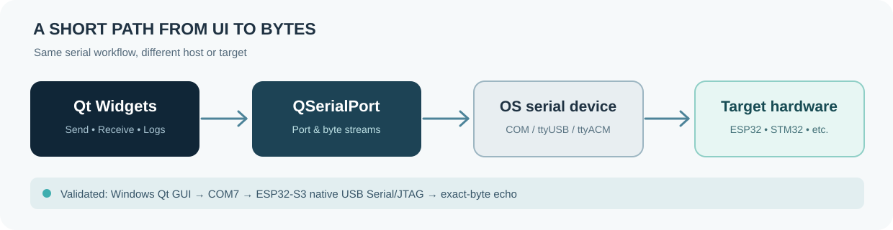

  

  
<strong>面向嵌入式开发者的轻量级、可复现串口调试工作台</strong> 
  A practical Qt serial workbench for embedded development.

  

    
    
    
    
  

  

    <a href="#-功能概览">功能</a> ·
    <a href="#-真实运行展示">运行展示</a> ·
    <a href="#-快速开始">构建</a> ·
    <a href="#-硬件验证">硬件验证</a> ·
    <a href="docs/ARCHITECTURE.md">架构</a> ·
    <a href="docs/VALIDATION.md">测试记录</a> ·
    <a href="docs/ROADMAP.md">路线图</a>
  

---

M_SERIAL 将串口连接、参数设置、数据收发、HEX 检视与日志保存集中在一个直观的 Qt 桌面窗口中。它通过 **Qt SerialPort 与操作系统串口设备通信**，不依赖指定 MCU 品牌：ESP32、STM32、Arduino 或其他开发板，只要提供兼容的串口设备及匹配的通信参数，就可以连接。

项目源于嵌入式 Linux Qt 课程设计，已在 **Windows x64 + ESP32-S3 原生 USB Serial/JTAG** 环境进行端到端测试；此前也已在 RK3568 开发板上启动运行。这里保留真实已实现的能力和已验证的证据，不把计划中的功能写成现有功能。

## ✦ 真实运行展示

实际 Windows Qt 运行画面：COM7 · 115200 · 8N1 · ESP32-S3 USB Serial/JTAG。发送与接收内容来自真实硬件回显。

<strong>展开：真实收发演示 GIF（文本 / 中文 / HEX）</strong>

 

 
GIF 由实际运行窗口逐帧录制，并非界面概念图或模拟数据。

## ✦ 功能概览

| 工作环节 | 当前已实现的能力 |
| :--- | :--- |
| 连接 | 扫描与刷新串口、打开/关闭连接、自动刷新未连接端口 |
| 参数 | 波特率、数据位、校验位、停止位、流控 |
| 发送 | UTF-8 文本、HEX 字节、可选行尾、定时自动发送 |
| 接收 | 文本 / HEX 切换、可选接收时间戳 |
| 调试 | 清空发送区与接收区、状态栏反馈、保存接收日志为文本文件 |

**设计边界：** 当前是通用串口终端，而不是烧录工具、协议解析器或波形分析器；RS-232、RS-485 等电气接口需要相应转换硬件和驱动，不能把任意 USB 接口直接当作串口。

## ✦ 工作方式

源代码目前是精简的 Qt Widgets 单窗口实现，主要逻辑位于 <code>mainwindow.cpp</code>；未来提取独立的串口核心仍属于路线图，而非已经完成的架构。

## ✦ 快速开始

### Windows（已实际构建）

所需组件：Qt 6（包含 **Qt SerialPort**）、C++17、MinGW 或受支持的 Qt 桌面编译工具链。

~~~powershell
git clone https://github.com/musuixin01/m-serial.git
cd m-serial
qmake M_Serial.pro
mingw32-make -j2
~~~

也可以直接使用 Qt Creator 打开 <code>M_Serial.pro</code> 构建。开发验证使用 Qt **6.11.2 + MinGW 13.1**；在 Windows 上分发可执行文件时，还需要通过 <code>windeployqt</code> 部署对应 Qt DLL 和插件。

### 嵌入式 Linux / Linux x64

使用装有 Qt Widgets、Qt SerialPort 及适当交叉工具链的环境打开同一工程。RK3568 ARM64 版本曾成功启动运行；**当前仓库尚未提供 Linux x64 的本轮独立自动化构建证据**。有关平台状态见 [验证记录](docs/VALIDATION.md)。

### 使用

1. 连接具有 USB CDC、USB-UART 或 UART 转接接口的设备。
2. 选择系统识别的 COM/tty 串口，设置双方一致的波特率、数据位、校验位与停止位。
3. 点击「打开串口」，选择文本或 HEX 模式进行收发。
4. 按需启用时间戳、自动发送或保存日志。

## ✦ 硬件验证

仓库附有可复现的 [ESP32-S3 原生 USB 字节回显固件与测试脚本](examples/esp32s3-usb-echo/README.md)。

| 验收项目 | 真实结果 |
| :--- | :--- |
| Windows Qt 应用编译、打开 COM7 | 通过 |
| ASCII / UTF-8 中文发送与回显 | 通过 |
| HEX / 含 00、FF 的二进制字节 | 通过 |
| 全 256 字节取值 × 16 | **4096 / 4096 字节完全一致** |
| 连续数据流 | **8192 / 8192 字节完全一致** |
| 100 ms 定时自动发送 | 实测回显 |
| ESP32-S3 USB-JTAG 双核识别 | 通过 |
| Xtensa GDB 远程硬件断点与单指令执行 | 通过 |

> **证据与限制：** 以上仅表示对应环境和测试用例通过，不代表已对所有开发板、全部波特率或长期稳定性完成验证。完整记录见 [docs/VALIDATION.md](docs/VALIDATION.md)。

## ✦ 仓库结构

~~~text
M_Serial/
├── main.cpp / mainwindow.cpp / mainwindow.h / mainwindow.ui
├── M_Serial.pro                 # Qt Widgets + Qt SerialPort / C++17
├── assets/
│   ├── hero.svg                # 项目专属视觉封面
│   ├── screenshot-windows.png  # 真实运行截图
│   ├── real-serial-demo.gif    # 真实收发演示
│   └── signal-flow.svg         # 信号路径图
├── docs/
│   ├── ARCHITECTURE.md
│   ├── VALIDATION.md
│   └── ROADMAP.md
└── examples/esp32s3-usb-echo/
    ├── main/usb_echo_main.c
    ├── CMakeLists.txt
    ├── sdkconfig.defaults
    └── test_usb_echo.py
~~~

## ✦ 当前状态与下一步

Windows 版与 ESP32-S3 回环测试已经通过。接下来优先处理 **异常拔插恢复、跨块 UTF-8 解码、严格 HEX 校验、接收缓冲上限**，并补齐 Linux x64 与 ARM64 的系统化回归测试。具体范围与验收标准见 [Roadmap](docs/ROADMAP.md)。

本仓库目前未选择开源许可证；分享源代码不等同于授予第三方复制、修改或商用权限。